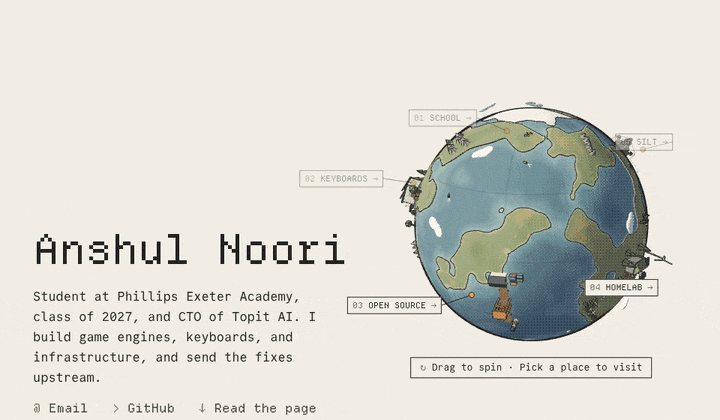
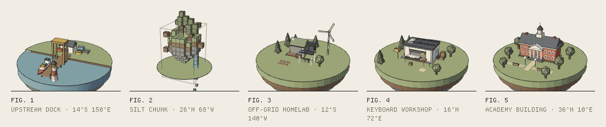
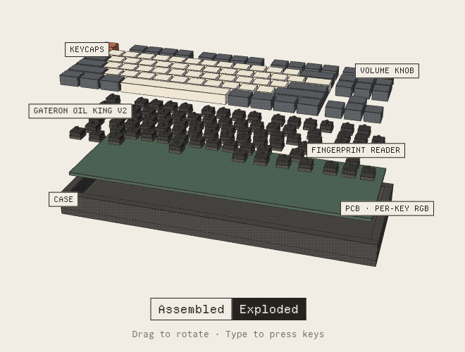
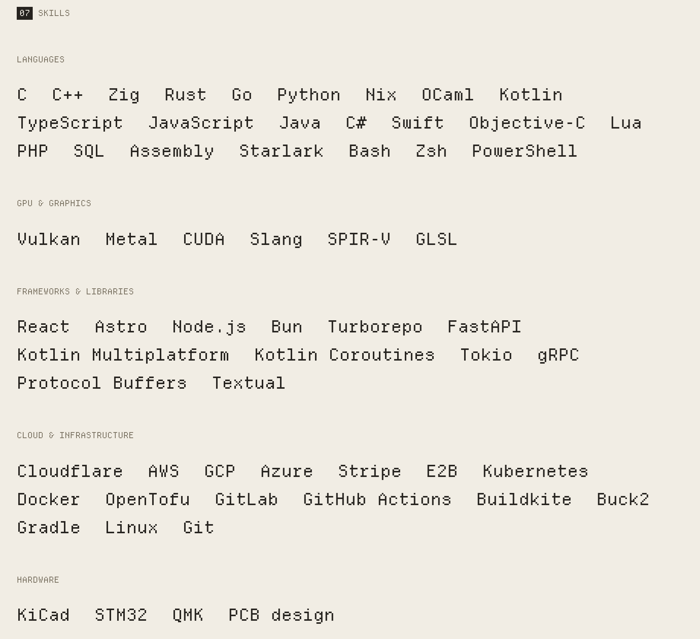

<a href="https://anshulnoori.com">
  <picture>
    <source media="(prefers-color-scheme: dark)" srcset=".github/readme/globe-dark.gif">
    
  </picture>
</a>

```
NOORI(1)                       Exeter, Class of 2027                       NOORI(1)

NAME
     anshul noori -- student, CTO of Topit AI, upstream contributor

SYNOPSIS
     noori [--build-systems] [--graphics] [--keyboards] [--infrastructure]

DESCRIPTION
     Student at Phillips Exeter Academy. Builds game engines, keyboards, and
     infrastructure, and sends the fixes upstream.

     Patches merged into Buck2, SPIRV-Cross, MoltenVK and nixos-apple-silicon.

SEE ALSO
     https://anshulnoori.com    mailto:anoori2@exeter.edu
```

### UPSTREAM

| PR                                                                                                     | Project                      | What changed                                                                             |
| ------------------------------------------------------------------------------------------------------ | ---------------------------- | ---------------------------------------------------------------------------------------- |
| [facebook/buck2#1418](https://github.com/facebook/buck2/pull/1418)                                     | Meta's build system · Rust   | Go builds share a remote cache: 501 of 526 build steps reused instead of rerun.          |
| [KhronosGroup/SPIRV-Cross#2666](https://github.com/KhronosGroup/SPIRV-Cross/pull/2666)                 | Shader translator · C++      | A depth setting Metal lacks, so Vulkan programs render depth correctly on Apple devices. |
| [KhronosGroup/MoltenVK#2712](https://github.com/KhronosGroup/MoltenVK/pull/2712)                       | Vulkan on Apple · Obj-C++    | Depth-clip control, so games and apps that need it run on Macs and iPhones.              |
| [nix-community/nixos-apple-silicon#429](https://github.com/nix-community/nixos-apple-silicon/pull/429) | NixOS on Apple Silicon · Nix | Limine boot loader support.                                                              |
| facebook/buck2 · upcoming                                                                              | Rust                         | Live build and test results streamed to the dashboards Bazel users already use.          |
| Mic92/niks3 · upcoming                                                                                 | Go                           | Nix build cache server.                                                                  |

### PROJECTS

<picture>
  <source media="(prefers-color-scheme: dark)" srcset=".github/readme/plates-dark.gif">
  
</picture>

| Project                                                           | What it is                                                                            | Built with                |
| ----------------------------------------------------------------- | ------------------------------------------------------------------------------------- | ------------------------- |
| [Silt](https://github.com/anshulnoori/silt)                       | 3D game engine. Macs lacked a graphics feature it needed, so I added it to MoltenVK.  | Zig, Vulkan               |
| [20/20 Vision](https://github.com/anshulnoori/twentytwentyvision) | Minecraft mod. Distant terrain drawn at lower detail on the GPU.                      | Rust, Kotlin, Vulkan      |
| [Trading](https://github.com/anshulnoori/trading)                 | Automated trading. No real money moves without statistical checks and human approval. | Rust, Python, SQL         |
| [Gum](https://github.com/anshulnoori/gum)                         | Robotics framework, published for other FTC teams.                                    | Kotlin                    |
| [Hermes](https://github.com/anshulnoori/hermes-medicine-tracker)  | Medication safety app. Built solo in 24 hours; honorable mention.                     | Python, TypeScript, React |

### KEYBOARDS

<picture>
  <source media="(prefers-color-scheme: dark)" srcset=".github/readme/io80-dark.gif">
  
</picture>

**IO80** · 88 keys, volume knob, fingerprint reader, per-key lighting, 8,000 Hz polling. Every key works and none
interfere in 5,000 random key combinations, checked before manufacturing. KiCad, Python.

**Prometheus** · magnetic switches; users set how far each key must be pressed. KiCad.

### SKILLS

<picture>
  <source media="(prefers-color-scheme: dark)" srcset=".github/readme/skills-dark.png">
  
</picture>

---

<details>
<summary><code>anshulnoori.com</code> source</summary>

This repository is also the source of [anshulnoori.com](https://anshulnoori.com): a static Astro site with a three.js
globe, served as Cloudflare Workers static assets (no Worker script).

```sh
pnpm install
pnpm dev        # http://localhost:4321
pnpm check      # astro check + prettier
pnpm build      # writes dist/
pnpm preview    # serves dist/ with wrangler, as Cloudflare will
pnpm cv         # cv/resume.tex -> public/cv.pdf (needs latexmk)
```

1. Content: `src/data/site.ts`. Sections: `src/components/`. Styles: `src/styles/global.css`.
2. 3D: `src/scripts/world/` (planet, landmarks, IO80, diorama plates), all one dithered shader.
3. CV: edit `cv/resume.tex`, run `pnpm cv`, commit `public/cv.pdf`. It is served at `/cv.pdf`; `/cv` redirects there.
4. Keyboard: `1`-`9` jump to sections, `J`/`K` next/previous, `M` light/dark, `G` grid overlay. On the globe, `1`-`5`
   visit places, `←`/`→` step between them, `Esc` goes back.

Fonts (SIL OFL 1.1, licenses in `public/fonts/`): Commit Mono for body text, and Departure Mono v1.500 by Helena
Zhang for headings, subset to 9 KB:

```sh
pyftsubset DepartureMono-Regular.otf --flavor=woff2 --layout-features='*' \
  --no-hinting --desubroutinize --output-file=public/fonts/DepartureMono-Regular.woff2 \
  --unicodes="U+0020-007E,U+00A0-00FF,U+0131,U+0152-0153,U+2010-2027,U+2030-203A,U+2070-209F,U+20AC,U+2122,U+2190-21FF,U+2212,U+2215,U+221E,U+2248,U+2260,U+2264,U+2265,U+2318,U+2500-259F,U+25A0-25FF,U+2605,U+2606,U+2726,U+2727,U+2770-2771,U+276E-276F,U+276C-276D"
```

</details>
